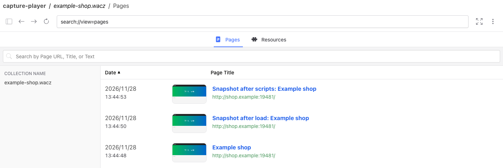
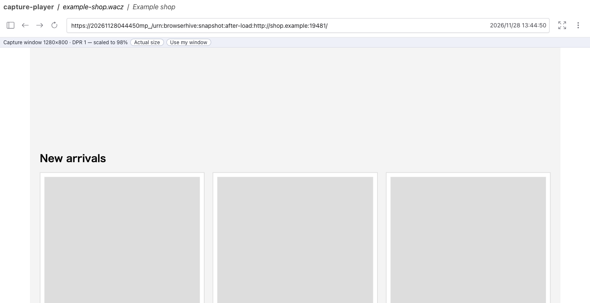
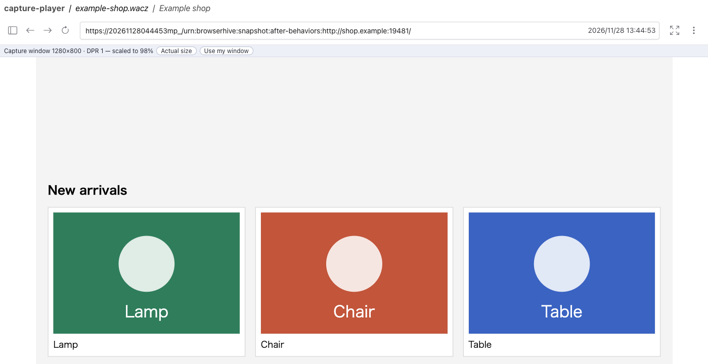
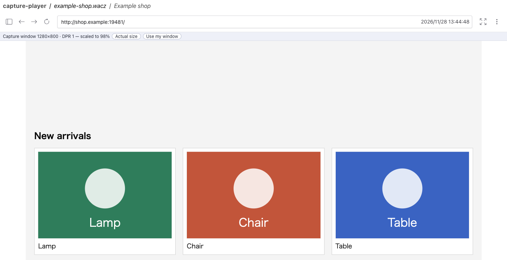

BrowserHive WACZ を開くと、頁の一覧に、同じ題と URL がたいてい 2 つか 3 つ並びます。

- **文書** — 頁の題だけ。例えば「Example shop」
- **Snapshot after load** — 「Snapshot after load: Example shop」
- **Snapshot after capture scripts** — 「Snapshot after capture scripts: Example shop」

どれも、1 つの頁を 1 回取り込んだ物です。違うのは、**いつ**撮った物か、ビューアが**どう**見せるかです。この頁は、その違いと、どれを見ればよいかを書きます。

## それぞれがいつできるか

BrowserHive は、ブラウザで頁を開き、ブラウザが受け取った応答を全部記録します。頁が落ち着くまで待ってから、ブラウザが持っている頁をそのまま写し（**写し**）、capture scripts（例えば、下までのスクロール）を走らせ、もう一度写します。

<figure>
<svg viewBox="0 0 760 230" width="100%" role="img" aria-label="1 回の取り込みの時の流れ: 文書の行は取り込みの始まり。頁が落ち着いたら Snapshot after load を写し、スクロールなどの capture scripts を走らせ、その後に Snapshot after capture scripts を写す。応答の記録は取り込みの間ずっと続く" style="max-width:760px;font-family:inherit">
  <defs><marker id="pages-arrow-ja" viewBox="0 0 10 10" refX="9" refY="5" markerWidth="7" markerHeight="7" orient="auto"><path d="M0,0L10,5L0,10z" style="fill:var(--sl-color-gray-3)"/></marker></defs>
  <g font-size="13" style="fill:var(--sl-color-white)">
    <line x1="20" y1="110" x2="740" y2="110" style="stroke:var(--sl-color-gray-3)" stroke-width="2" marker-end="url(#pages-arrow-ja)"/>
    <text x="740" y="100" text-anchor="end" font-size="11" style="fill:var(--sl-color-gray-3)">時</text>
    <rect x="40" y="122" width="210" height="28" rx="6" style="fill:none;stroke:var(--sl-color-gray-3)" stroke-dasharray="4 3"/>
    <text x="145" y="141" text-anchor="middle" font-size="11">読み込み、静かになるまで待つ</text>
    <rect x="370" y="122" width="250" height="28" rx="6" style="fill:none;stroke:var(--sl-color-gray-3)" stroke-dasharray="4 3"/>
    <text x="495" y="141" text-anchor="middle" font-size="11">capture scripts（下までスクロール など）</text>
    <line x1="40" y1="105" x2="40" y2="62" style="stroke:var(--sl-color-accent)" stroke-width="2"/>
    <circle cx="40" cy="110" r="5" style="fill:var(--sl-color-accent)"/>
    <text x="40" y="34" font-weight="bold">① 文書</text>
    <text x="40" y="52" font-size="11">時刻 = 取り込みの始まり</text>
    <line x1="310" y1="105" x2="310" y2="62" style="stroke:var(--sl-color-accent)" stroke-width="2"/>
    <circle cx="310" cy="110" r="5" style="fill:var(--sl-color-accent)"/>
    <text x="310" y="34" text-anchor="middle" font-weight="bold">② Snapshot after load</text>
    <text x="310" y="52" text-anchor="middle" font-size="11">頁の写し ＋ スクリーンショット</text>
    <line x1="680" y1="105" x2="680" y2="62" style="stroke:var(--sl-color-accent)" stroke-width="2"/>
    <circle cx="680" cy="110" r="5" style="fill:var(--sl-color-accent)"/>
    <text x="680" y="34" text-anchor="end" font-weight="bold">③ Snapshot after capture scripts</text>
    <text x="680" y="52" text-anchor="end" font-size="11">頁の写し ＋ スクリーンショット</text>
    <rect x="40" y="170" width="680" height="30" rx="6" style="fill:none;stroke:var(--sl-color-gray-3)"/>
    <text x="380" y="190" text-anchor="middle" font-size="12">ブラウザが受け取った応答を全部記録する（HTML・画像・スクリプト…）</text>
    <text x="380" y="222" text-anchor="middle" font-size="11" style="fill:var(--sl-color-gray-3)">① は開くたびにこの記録から作り直す。② ③ は写した物をそのまま出す</text>
  </g>
</svg>
<figcaption>1 回の取り込み。① の時刻は取り込みの始まり、② ③ の時刻はそれぞれを写した時。</figcaption>
</figure>

Capture scripts は、取り込みを頼む側が付けて、BrowserHive が頁の中で走らせるスクリプトです（例えば、下までスクロールする autoscroll）。決まりの上の名は、BrowserHive WACZ Profile 1.30.0 から `after-capture-scripts`、それより前の版では `after-behaviors` です。どちらも「Snapshot after capture scripts」と出ます。capture scripts を走らせなかった取り込みには ③ が無く、頁の一覧は ① と ② だけです。

## それぞれが何か

|                      | ① 文書                                                                      | ② Snapshot after load                                                   | ③ Snapshot after capture scripts                                        |
| -------------------- | --------------------------------------------------------------------------- | ----------------------------------------------------------------------- | ----------------------------------------------------------------------- |
| 何か                 | 記録した応答から**作り直した**頁                                            | 頁が落ち着いた時に、ブラウザが持っていた頁の**写し**。スクロールの前    | Capture scripts の後に、ブラウザが持っていた頁の**写し**                |
| 一覧の時刻           | 取り込みを始めた時                                                          | 写した時                                                                | 写した時                                                                |
| 頁の JavaScript      | 見る人のブラウザで**動く**。動画・メニュー・スライドが動く                  | **動かない**。写す時に BrowserHive がスクリプトを外した                 | **動かない**                                                            |
| 下の方の画像         | 取り込みが記録していれば出る（たいてい capture scripts が頁に読ませている） | 見える所に来てから画像を読む頁では、**出ない**ことが多い                | capture scripts がスクロールして読ませた後なので、出る                  |
| 撮った時と違い得るか | 違い得る。開くたびに組み立て直すので、頁が見せていた物と同じとは限らない    | HTML は写した時のまま。見る人のブラウザが、記録した画像・スタイルで描く | HTML は写した時のまま。見る人のブラウザが、記録した画像・スタイルで描く |

一覧の小さな絵は、BrowserHive が ② と ③ の時に撮ったスクリーンショットです（文書の行は ② の物を使います）。スクリーンショットに写るのは頁の上の、取り込みの窓の大きさの所だけなので、下の方が違っても、絵は同じに見えることがよくあります。

## 例: スクロールで読む画像

多くの頁は、画像を、そこまでスクロールした時に初めて読みます。それまで頁が持つのは空の仮の画像です。② はスクロールの前に写すので、そうした画像は仮の画像のままです。③ は autoscroll の capture script が頁を下までスクロールした後に写すので、画像があります。

下の画面は、商品の絵をスクロールで読む小さな見本の頁「Example shop」を 1 回取り込んだ物です。3 つとも同じ所までスクロールしてあります。

**② Snapshot after load** — 商品の絵は灰色の仮の画像のまま:

**③ Snapshot after capture scripts** — 絵がある:

**① 文書** — こちらも絵がある。頁の JavaScript がもう一度動き、アーカイブから絵を読むため（autoscroll が絵を記録していた）:

写しの住所の欄には、`urn:browserhive:snapshot:` の住所が出ます。写しは、元の URL が返した応答ではないためです。

## どれを見ればよいか

| 知りたいこと                                                                                     | 見る物                           |
| ------------------------------------------------------------------------------------------------ | -------------------------------- |
| 頁がどう動いたか: リンクを辿る・メニューを開く・動画を流す                                       | ① 文書                           |
| 来た人が、スクロールする前に見た物（頁が落ち着いた後。取り込みが外した帯は無い）                 | ② Snapshot after load            |
| 取り込みの終わりに頁が持っていた物の全部（スクロールして初めて出る物を含む）                     | ③ Snapshot after capture scripts |
| ① が崩れる・真っ白になる時（頁の JavaScript がビューアの中でうまく動かない）に、頁が持っていた物 | ② か ③                           |

### 取り込みを証拠として見る時

- **頁の見た目そのもの**を示すのは、スクリーンショットだけです。写し（② ③）は、その時ブラウザが持っていた頁の HTML を残した物で、後から応答で作り直しません。開くと、見る人のブラウザが、その HTML を記録した画像・スタイル・字体で、撮った時の窓の大きさで描き直します。1 つ残すなら ③ です。取り込みの終わりの姿で、スクロールして初めて出る物も含みます。来てすぐの見た目が要る時は ② も足します。
- **サーバが送った物**を記録しているのは応答です。受け取ったまま残しますが、アーカイブが本文を残さなかった所（数は Archive Info に出ます）と、秘密の値を置き換えた所（`browserhive:capture` の `settings.secrets` が取り込みの秘密の名を言い、値を置き換えた応答には WARC の中で印が付きます）は別です。① はそれを見る人のブラウザで頁をもう一度動かして見せるので、① が描く絵は、今、頁の JavaScript をもう一度動かして作った物です。時刻と乱数は再生の値で、取り込みの時に頁が見た値とは限りません（[記録した乱数](../what-it-changes/#記録した乱数) を参照）。① だけで、画面に何が出ていたかを言わないでください。
- 取り込み自身が、残す物を変えることがあります。秘密の値を置き換え、写す前に同意の帯を外すことがあり（dismissal）、capture scripts が要素を足すことがあります。dismissal と秘密は `datapackage.json` の `browserhive:capture` が記録します。capture scripts が足した要素には、写しの中で `data-capture-script` が付き、capture-player がその数を頁の上の帯に出します。
- スクリーンショットに写るのは頁の上の方だけです。頁の全部は写しにあります。スクリーンショットが 1 枚も無い取り込みもあります（撮るよう求めなかった時・秘密を持つ取り込みの時など）。訳は `browserhive:capture` の `screenshots` が言います。
- アーカイブが後から変えられていないかは別の問いで、どの頁を見るかでなく署名が答えます（署名があるかは Archive Info に出ます）。

## 決まりの在り処

頁の一覧と写しは、BrowserHive WACZ Profile が決めています: [Pages](https://uraitakahito.github.io/browserhive-specs/wacz-profile/1.28.0/#pages)・[snapshots](https://uraitakahito.github.io/browserhive-specs/wacz-profile/1.28.0/#snapshots)・[screenshots](https://uraitakahito.github.io/browserhive-specs/wacz-profile/1.28.0/#screenshots)。capture-player が頁の一覧で変えたこと（「Snapshot after …」の題と小さな絵）は、[上流から変えたこと](../what-it-changes/) にあります。
