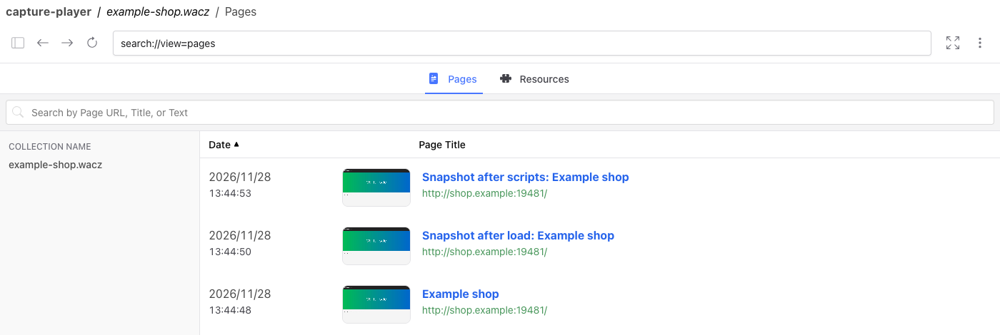
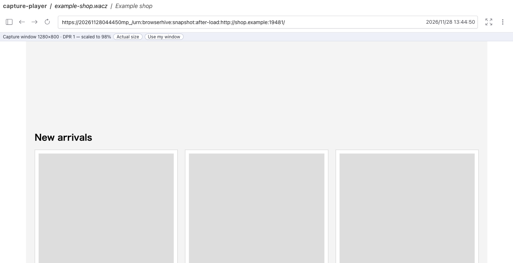
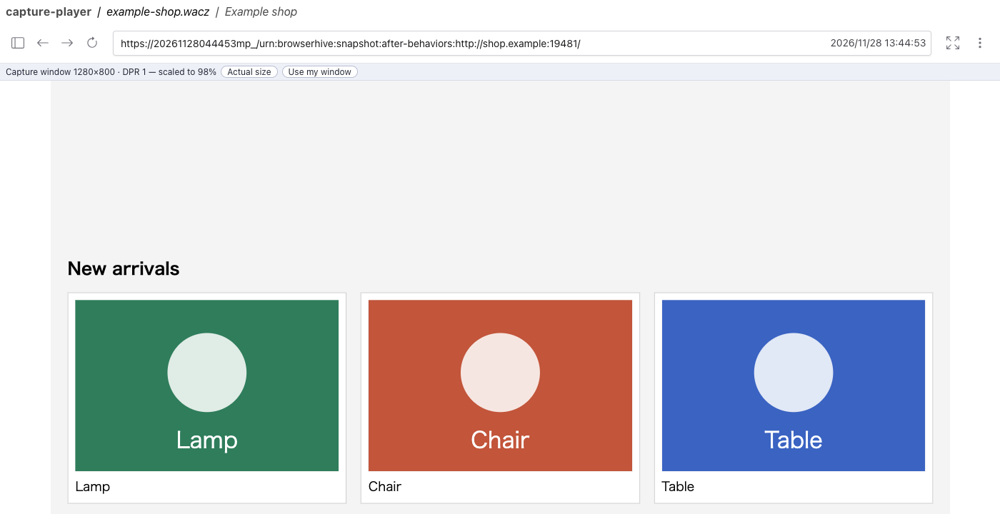
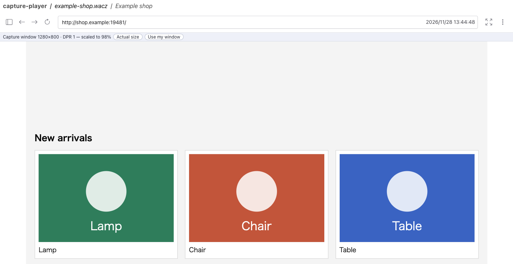

When you open a BrowserHive WACZ, the page list usually shows the same title
and URL two or three times:

- **the document** — just the page title, for example "Example shop"
- **Snapshot after load** — "Snapshot after load: Example shop"
- **Snapshot after scripts** — "Snapshot after scripts: Example shop"

They are one capture of one page. They differ in **when** they were taken and
in **how** the viewer shows them. This page explains the difference and which
one to look at.

## When each one is made

BrowserHive opens the page in a browser and records every response the browser
receives. It waits until the page has settled, copies the page as the browser
holds it (a **snapshot**), runs the capture's behaviors (for example, scrolling
to the bottom), and copies the page again.

<figure>
<svg viewBox="0 0 760 230" width="100%" role="img" aria-label="Timeline of one capture: the document page is the start of the capture; Snapshot after load is taken when the page has settled; behaviors such as autoscroll run; Snapshot after scripts is taken after them; recording of responses continues through the whole capture" style="max-width:760px;font-family:inherit">
  <defs><marker id="pages-arrow" viewBox="0 0 10 10" refX="9" refY="5" markerWidth="7" markerHeight="7" orient="auto"><path d="M0,0L10,5L0,10z" style="fill:var(--sl-color-gray-3)"/></marker></defs>
  <g font-size="13" style="fill:var(--sl-color-white)">
    <line x1="20" y1="110" x2="740" y2="110" style="stroke:var(--sl-color-gray-3)" stroke-width="2" marker-end="url(#pages-arrow)"/>
    <text x="740" y="100" text-anchor="end" font-size="11" style="fill:var(--sl-color-gray-3)">time</text>
    <rect x="40" y="122" width="210" height="28" rx="6" style="fill:none;stroke:var(--sl-color-gray-3)" stroke-dasharray="4 3"/>
    <text x="145" y="141" text-anchor="middle" font-size="11">load, then wait until quiet</text>
    <rect x="370" y="122" width="250" height="28" rx="6" style="fill:none;stroke:var(--sl-color-gray-3)" stroke-dasharray="4 3"/>
    <text x="495" y="141" text-anchor="middle" font-size="11">behaviors (scroll to the bottom, …)</text>
    <line x1="40" y1="105" x2="40" y2="62" style="stroke:var(--sl-color-accent)" stroke-width="2"/>
    <circle cx="40" cy="110" r="5" style="fill:var(--sl-color-accent)"/>
    <text x="40" y="34" font-weight="bold">① the document</text>
    <text x="40" y="52" font-size="11">time = start of the capture</text>
    <line x1="310" y1="105" x2="310" y2="62" style="stroke:var(--sl-color-accent)" stroke-width="2"/>
    <circle cx="310" cy="110" r="5" style="fill:var(--sl-color-accent)"/>
    <text x="310" y="34" text-anchor="middle" font-weight="bold">② Snapshot after load</text>
    <text x="310" y="52" text-anchor="middle" font-size="11">copy of the page + screenshot</text>
    <line x1="680" y1="105" x2="680" y2="62" style="stroke:var(--sl-color-accent)" stroke-width="2"/>
    <circle cx="680" cy="110" r="5" style="fill:var(--sl-color-accent)"/>
    <text x="680" y="34" text-anchor="end" font-weight="bold">③ Snapshot after scripts</text>
    <text x="680" y="52" text-anchor="end" font-size="11">copy of the page + screenshot</text>
    <rect x="40" y="170" width="680" height="30" rx="6" style="fill:none;stroke:var(--sl-color-gray-3)"/>
    <text x="380" y="190" text-anchor="middle" font-size="12">every response the browser receives is recorded (HTML, images, scripts, …)</text>
    <text x="380" y="222" text-anchor="middle" font-size="11" style="fill:var(--sl-color-gray-3)">① is rebuilt from these recorded responses when you open it; ② and ③ are shown as they were copied</text>
  </g>
</svg>
<figcaption>One capture. ① is dated at the start of the capture; ② and ③ at the moment each copy was made.</figcaption>
</figure>

"Scripts" in "Snapshot after scripts" means the **behaviors BrowserHive ran**,
not the page's own JavaScript. The specification calls this stage
`after-behaviors`. A capture that ran no behaviors has no ③: its page list has
only ① and ②.

## What each one is

|                         | ① the document                                                                                | ② Snapshot after load                                                                   | ③ Snapshot after scripts                                                         |
| ----------------------- | --------------------------------------------------------------------------------------------- | --------------------------------------------------------------------------------------- | -------------------------------------------------------------------------------- |
| What it is              | The page **rebuilt** from the recorded responses                                              | A **copy** of the page as the browser held it once it had settled, before any scrolling | A **copy** of the page as the browser held it after the behaviors                |
| Time in the list        | When the capture started                                                                      | When the copy was made                                                                  | When the copy was made                                                           |
| The page's JavaScript   | **Runs** in your browser. Videos, menus and carousels move                                    | **Does not run.** BrowserHive took the scripts out when it made the copy                | **Does not run**                                                                 |
| Images below the fold   | Shown if the capture recorded them (the behaviors usually make the page load them)            | Often **missing**, if the page loads images only when they scroll into view             | Shown, once the behaviors scrolled them into view                                |
| Can differ from capture | Yes. It is put together again each time you open it, so it is not always what the page showed | The HTML is as copied. Your browser draws it with the recorded images and styles        | The HTML is as copied. Your browser draws it with the recorded images and styles |

The thumbnails in the list are the screenshots BrowserHive took at ② and ③
(the document uses the one from ②). A screenshot shows only the top of the
page, the size of the capture window, so the thumbnails often look the same even
when the pages below differ.

## An example: images that load on scroll

Many pages load an image only when you scroll to it. Until then, the page holds
an empty placeholder. ② is copied before anything scrolls, so those images are
still placeholders in it. ③ is copied after the autoscroll behavior has
scrolled the whole page, so they are there.

The screenshots below are one capture of a small sample page, "Example shop",
whose product pictures load on scroll. All three are scrolled to the same place.

**② Snapshot after load** — the product pictures are still the grey placeholders:

**③ Snapshot after scripts** — the pictures are there:

**① the document** — the pictures are there too, because the page's JavaScript
runs again and loads them from the archive (the autoscroll had recorded them):

The address bar of a snapshot shows its `urn:browserhive:snapshot:` address,
because a snapshot is not a response from the original URL.

## Which one to look at

| You want to know                                                                                          | Look at                  |
| --------------------------------------------------------------------------------------------------------- | ------------------------ |
| How the page behaved: follow links, open menus, play videos                                               | ① the document           |
| What a visitor saw before scrolling (after the page settled; a banner the capture dismissed is not in it) | ② Snapshot after load    |
| Everything the page held at the end of the capture, including what appears only after scrolling           | ③ Snapshot after scripts |
| What the page held, when ① looks broken or blank (its JavaScript does not run well inside the viewer)     | ② or ③                   |

### When the capture is evidence

- **What the page looked like** is shown only by the screenshots. A snapshot
  (② or ③) keeps the page's HTML as the browser held it at that moment, and is
  not rebuilt from the responses later. When you open it, your browser draws that
  HTML again with the recorded images, styles and fonts, in the capture window.
  If you keep one, keep ③: it is the state at the end of the capture, including
  content that appears only after scrolling. Add ② when the first view matters.
- **What the server sent** is recorded by the responses. They are kept as
  received, except where the archive did not keep a body (Archive Info shows how
  many) or replaced a secret value (`settings.secrets` in `browserhive:capture` names
  the capture's secrets, and each response whose values were replaced is marked
  in the WARC). ① shows them by running the page again in
  your browser, so the picture ① draws is made now, by today's run of the page's
  JavaScript. Date and random values are replayed, not live, and are not always
  the values the page saw during the capture (see
  [Recorded random values](../what-it-changes/#recorded-random-values)). Do not
  use ① alone to say what was on the screen.
- The capture itself can change what it keeps. It replaces secret values, may
  remove a consent banner before it copies the page (the dismissal), and capture
  scripts may add elements. `browserhive:capture` in `datapackage.json` records
  the dismissal and the secrets; elements a capture script added carry
  `data-capture-script` in the snapshot, and capture-player counts them in the
  bar above the page.
- A screenshot covers only the top of the page. The whole page is in the
  snapshot. Some captures have no screenshots at all (for example when they were
  not asked for, or when the capture had secrets); `screenshots` in
  `browserhive:capture` says why.
- Whether the archive was changed afterwards is a separate question: it is
  answered by the signature (Archive Info shows whether the archive is signed),
  not by which page you look at.

## Where this is specified

The page list and the snapshots are defined by the BrowserHive WACZ Profile:
[Pages](https://uraitakahito.github.io/browserhive-specs/wacz-profile/1.28.0/#pages),
[snapshots](https://uraitakahito.github.io/browserhive-specs/wacz-profile/1.28.0/#snapshots)
and
[screenshots](https://uraitakahito.github.io/browserhive-specs/wacz-profile/1.28.0/#screenshots).
What capture-player changes in the page list (the "Snapshot after …" titles and
the thumbnails) is in [What it changes](../what-it-changes/).
